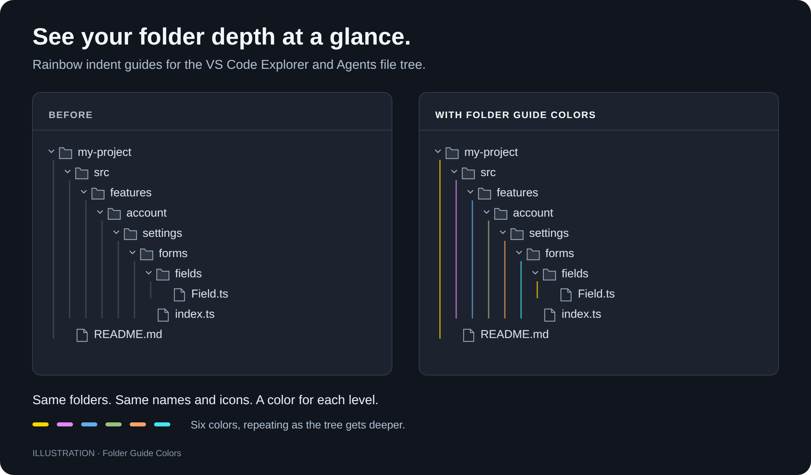

# Folder Guide Colors

**Rainbow indent guides for the VS Code Explorer.**

Folder Guide Colors gives each level of your folder tree a different line color. Follow the vertical lines to see which files belong to which folder, even in deeply nested projects.



*Illustration of the effect, not a screenshot. Colors repeat every six levels.*

## What it does

- Automatically colors the **vertical indent guide lines** in the built-in file Explorer.
- Works in both the regular VS Code window and the **Agents window**.
- Uses six colors: gold, purple, blue, green, orange, and cyan.
- Restores the colors when you reopen VS Code.
- Works with **Linux Snap installations** without changing VS Code installation files or requiring `sudo`.

File names, folder icons, and backgrounds keep their original appearance. There is no need to assign colors to individual folders. Colors follow the visible tree depth, including when VS Code displays compact folders.

## Install and enable

Requires desktop VS Code **1.113.0 or newer**. See [compatibility](#compatibility) for the version tested so far.

1. Get the `folder-guide-colors-0.1.0.vsix` package, or [build it from source](#build-from-source).
2. Open the Command Palette with `Ctrl+Shift+P` and run **Extensions: Install from VSIX…**. Select the package.
3. Run **Folder Guide Colors: Enable** and confirm the local debugging port prompt.
4. Save your work, **fully close all VS Code windows**, then open VS Code again. **Reload Window is not enough for the first setup.**

Expand a few nested folders in Explorer. Their guide lines will be colored automatically. New windows and reloaded windows normally pick up the colors within about two seconds.

> **Why the debugging port?** The extension applies a small style through a local connection to VS Code. This avoids editing the installation, which is read-only in Snap. Other local processes can also use this port to control the VS Code interface. Enable it only if you are comfortable with that access, and keep the port local to your machine.

## Disable or uninstall

Run **Folder Guide Colors: Disable** to remove the colors from available windows and stop applying them.

**Run Disable before uninstalling.** If the extension added the debugging port setting, it removes that setting when you disable it, provided you have not changed it. A port you configured yourself is kept. Fully exit VS Code to close a port that is already running.

## Compatibility

| Environment | Status |
| --- | --- |
| Linux, VS Code installed through Snap | Tested on VS Code **1.145.2** in an isolated test profile |
| Regular Explorer and Agents file tree | Tested, including startup with only the Agents window open |
| Windows | Code includes Windows path handling; **not yet tested on Windows** |
| Other desktop VS Code versions and Linux packages | Not yet tested |
| Browser-based VS Code, such as vscode.dev | Not supported |

The extension runs on the local UI side when you use SSH or WSL. All windows and profiles of the same VS Code installation share its enabled state.

This extension uses internal VS Code styling rather than a stable customization API. A future VS Code update may require an extension update. See the [verification report](docs/verification.md) for detailed test results and limits.

## Troubleshooting

**No lines are visible:** open Settings and search for **Workbench › Tree: Render Indent Guides**. Choose `always` to keep the guides visible. Expand nested folders so there are guide lines to color.

**Lines are still gray:** run **Folder Guide Colors: Enable**, then fully close **all** VS Code windows and reopen the app. The first setup needs a full restart, not just **Reload Window**.

**Still not working:** open **View → Output** and select **Folder Guide Colors**. The log shows connection errors and how many windows were updated. Check that the configured local port is available. Do not use `--no-sandbox` or expose the debugging port to work around a connection problem.

## Build from source

Use a recent Node.js LTS release with npm. From the project folder, run:

```sh
npm ci --ignore-scripts
npm test
npm run check
npm run package
```

The installable VSIX is written to `dist/`. Install it using the steps above.

Optional visual checks:

```sh
# Check computed guide colors in Google Chrome.
# Set CHROME_PATH if Chrome is installed elsewhere.
node scripts/check-browser.js

# Test the packaged extension in an isolated Linux Snap profile.
node scripts/check-snap.js
```

## How it works

When enabled, the extension saves a local debugging port in VS Code's user runtime configuration. It connects to the native Explorer windows through the Chrome DevTools Protocol (CDP) and adds a small style for the indent guide lines. It reapplies the style after a window opens or reloads.

Its own state is stored in `folder-guide-colors.json` beside the user runtime configuration. Existing settings and JSONC comments are preserved. VS Code installation files are never patched.

## License and credits

[MIT](LICENSE). Adapted styling and injection patterns from **Colorize Folder Tree** and **slack-themes** are credited in [Third-party notices](THIRD_PARTY_NOTICES.md), with their original licenses included.
